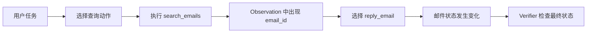

# 第一课：一个工具调用为什么还不是一个 Agent

假设用户说：“回复 Carlos 那封关于原型开发的最新邮件。”模型首先需要知道邮件 ID。用户给的是人的描述，数据库需要的是可执行参数，两者之间的桥梁通常是查询工具。



今天 A/B 由脚本选择。未来要由开放权重 LLM 根据 messages 生成，才是在测 Agent policy。

## State 与 Observation 不相同

State 是环境内部完整事实，例如邮件表的全部记录。Observation 是某个工具这一次返回给 policy 的信息，可能只有一页搜索结果。policy 通常看不到全部 state，只能通过工具逐步获得信息。

查询可能不改变 state，但它改变了 policy 能看到的信息。回复邮件会改变 state。Stateful 指后一次动作面对的环境可能已经被前一次动作改变；它不只是“聊天记录比较长”。

打开 `learning_lab.py --view trace`：第一步搜索应没有业务状态变化；第二步回复会出现改变的状态表。参数中的 ID 来自第一步真实 observation，这叫 identifier grounding。一个 ID 即使碰巧存在，如果没有可追溯来源，也不能据此证明 policy 会 grounding。

## Reset 与隔离为什么重要

做完任务后直接运行下一条，如果前一条发送的邮件还在，就可能改变后一条查询的“最新邮件”。同样，两个 rollout 如果共用对象，会互相污染。

我们的适配层为每个实例创建新的官方工具对象。reset 从固定 CSV 恢复。今天验证了：A 的写操作不改变 B；A reset 后回到初始状态。不要把这种测试叫模型能力，它是在确认实验条件可靠。

环境时钟是任务语义的一部分：官方任务使用 2023-11-30 23:59。不能因为电脑今天是 2026 年，就把任务中的 today/tomorrow 全部按今天解释。

## 官方 reward 到底检查什么

当前实现创建两份新环境：一份重放预测动作，一份重放参考动作，最后比较五个业务状态表。

```text
R = 1，若预测动作与参考动作得到相同的最终业务状态
R = 0，否则
```

它允许不同路径到达同一结果，也允许错误后恢复。这是有用的性质。但它不直接检查最终自然语言是否诚实、是否先查询过、是否凭空猜中了 ID。

真实 DEV 709 中，没有匹配的未来会议。查询工具返回 `No events found.`，随后不做修改是合理的。但不查询、直接结束也得到同样 reward。我们不能把这个事实写成“任务标错”；正确结论是该 reward 看不到决策依据。

今天加一个不存在的工具再执行正确动作仍可得分。不要因此规定“有一次错误就必须 rejected”：合理 recovery 可能是很好的训练样例。应结合最终结果、错误原因和过程质量判断。

## 你应能复述

用自己的话解释：用户的描述如何变成数据库 ID；为什么查询也是重要的一步；为什么 reward=1 仍不代表全部 Agent 行为可靠。然后找出 `WorkplaceEnv.step` 和 `is_correct` 分别负责哪一段。
