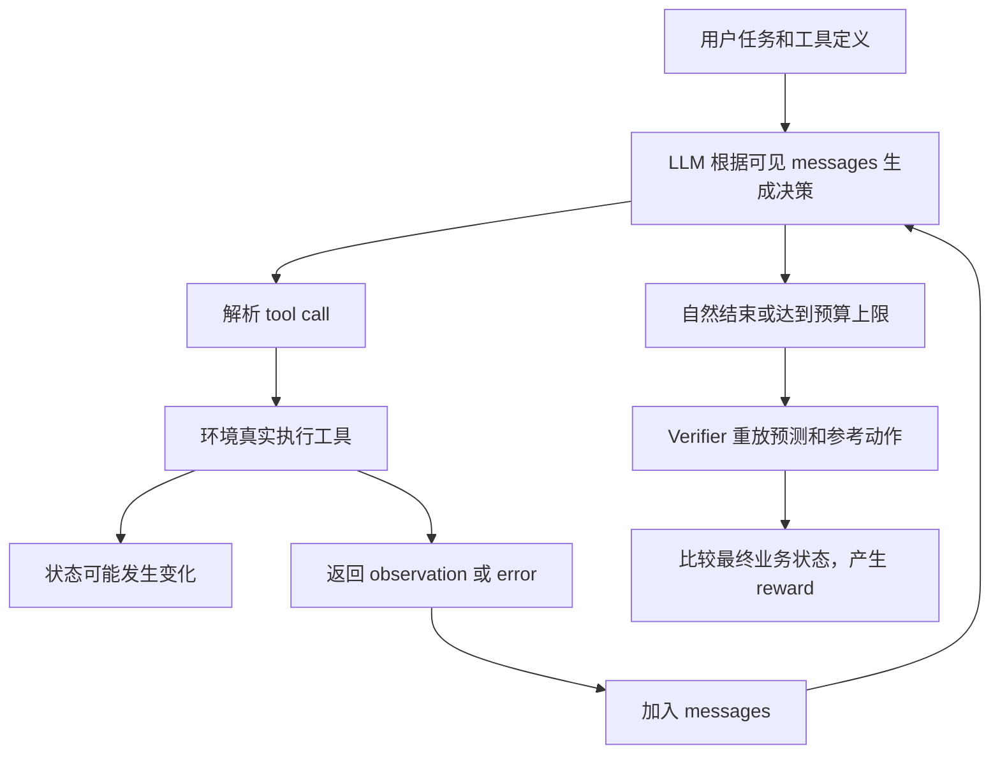

# 三天后重新接上项目：VeriAgent-Workplace 学习合订本

整理日期：2026-09-08，现为手机学习与代码详解版。整合此前第一至第四课、CPU 考核、Day 3 报告；第 11 章直接嵌入关键源码、真实轨迹和 token 样例，附逐段讲解。晚上只需把这一份 Markdown 交给 GPT，无须打开笔记本、仓库或运行代码。文内文件路径用于追溯，不是阅读前提。本文没有新增实验结果。

你现在最需要恢复的是这条因果链：**模型看到任务 → 自己选择动作 → 工具真实执行 → 模型依据返回信息继续决策 → 检查最终状态 → 分析失败 → 设计训练数据 → 更新参数 → 在独立数据上检验改善。** 本项目已经走到“分析失败”，还没有完成参数更新。

建议分四段阅读，可以分两晚或更多次，不要求一次记住所有数字：

| 时间安排（建议） | 阅读内容 | 读完应能做什么 |
|---|---|---|
| 第一段，30 分钟 | 1–4：项目状态、环境、轨迹、真实错误 | 用一个例子解释 Agent 如何做事、如何失败 |
| 第二段，35–45 分钟 | 5–8：指标、切分、SFT、DPO/RL | 分清实验分母、训练输入和监督目标 |
| 第三段，45–60 分钟 | 11.1–11.11：嵌入源码与 task 0 | 追踪模型生成、解析、工具执行、状态变化与评分 |
| 第四段，40–60 分钟 | 9–10、11.12–11.15、12：训练代码机制与考核 | 用文内 token / task 18 证据理解 mask、loss 和偏好 |

第一次读时，四个 prefill token 和 DPO 公式可以先理解边界，第二遍再核对细节。第 11.15 节附有可直接交给 GPT 的逐段教学请求。不要把阅读时间当作掌握程度。

## 1. 先恢复项目定位与进度

研究问题是：**固定训练 token 和 GPU 预算时，针对 Base 主要失败选择高质量轨迹，能否比随机选择高质量成功轨迹，更有效地改善 Agent？** 后续还要研究偏好优化能否利用失败轨迹中的相对信息，以及改善是否泛化到未见任务或工具依赖组合。

| 名称 | 本项目中的含义 | 当前状态 |
|---|---|---|
| Q0 | 资格审计：环境、模型和预算是否适合继续投入 | 已完成 CPU 审计与 Day 3 小规模推理；仍有未通过门槛 |
| B0 | 未经本项目微调的 Qwen3-8B 基线 | 已测 24 题 × 两个 seed |
| B1 | 同一模型追加一版通用 system 指令 | 已按预登记条件测 24 题 × 一个 seed |
| S1 | 从合格成功池随机选择轨迹做 SFT | 未执行 |
| S2 | 根据 Base 失败分布选择轨迹做 SFT | 未执行；S1 vs S2 是核心对照 |
| P1 | Verified Trajectory DPO | 未执行 |
| R1 | 可选、当前 policy 在线采样的 GRPO/RLVR | 未执行；不作为项目成立的必要条件 |

这里的 Base/B0 是“本项目微调前的基线”，不是说我们用了另一个名为 Qwen3-8B-Base 的 checkpoint。实际模型是 `Qwen/Qwen3-8B`。

**按证据分成两个历史阶段：**

- CPU 阶段：运行了 138 条脚本轨迹，检查真实工具、reset、隔离、重放、verifier，并使用真实 tokenizer 检查模板与 mask。动作由脚本选择，不能算模型成功率。
- Day 3（2026-09-04）：运行了 75 条真实模型轨迹，包含 3 条 smoke、48 条 B0、24 条 B1。全部在线状态与重放一致。模型没有 optimizer、没有反向传播，trainable parameter count=0；参数采样指纹前后不变。

因此现在能说“完成了真实 Agent 推理与失败分析”，还不能说“完成了 Agent Post-Training”。SFT/DPO 的 forward、反向传播、adapter 更新、保存重载和独立评测都是后续工作。

Day 3 的硬件和交互链通过；B0 没通过预登记的成功任务数量门槛。B1 是有条件候选，整个 Q0 不能概括为无条件通过。学习与考核目前仍未评分。

## 2. 从一封邮件理解 Task、Policy、Tool、State

假设用户要求回复某人的某封邮件。用户给的是描述，工具需要的是具体邮件 ID。通常需要先查询，再从返回结果中取 ID，最后执行回复。



| 术语 | 你可以怎样理解 | 本项目例子 |
|---|---|---|
| Task | 用户要达成的目标 | 回复指定邮件 |
| Policy | 根据已有信息选择下一步的模型 | Qwen3-8B 生成查询或回复调用 |
| Tool schema | 工具名、用途、参数约束 | 回复工具需要 email_id |
| Tool call / action | 模型选择的一次具体调用 | 某个工具名及其 JSON arguments |
| State | 环境内部当前的完整事实 | 邮件表、日历表等业务数据 |
| Observation | 某次调用实际返回给模型的内容 | 搜索结果中的邮件列表和 ID |
| Trajectory / rollout | 一次任务从开始到结束的完整交互 | 查询、错误、重试、回复及最终验证 |

**State 与 observation 不同。** 数据库可能有很多记录，一次查询只返回其中一部分。模型通常只能依据可见的任务、工具定义和 observations 决策；记录系统能保存完整 state，不表示这些 state 全都给了模型。

查询不一定改变业务表，但会改变模型掌握的信息。写操作会影响之后的查询和动作。这就是 stateful 的关键；聊天记录很长本身并不充分说明业务环境是 stateful。

**每条 rollout 必须从规定的初始状态开始。** 如果上一条已经回复邮件，下一条却直接沿用它的环境，“最新邮件”可能就变了。当前 `WorkplaceEnv.reset` 创建新的官方工具对象；CPU 阶段检查过实例隔离和 reset。环境使用固定任务时钟 2023-11-30 23:59，不能把任务中的 tomorrow 按你的电脑日期解释。

固定源码快照下，环境有 27 个工具、五个可变业务状态域，以及只读 company directory。工具/状态是工作场景模拟：例如 plot 工具记录输出路径，不代表真的渲染了 PNG。应按已验证的环境语义解释结果。

## 3. Verifier、reward 与高质量成功

官方 verifier 为预测动作与参考动作分别创建新环境并重放，比较五个业务状态表。理解上可写成：

```text
reward = 1：预测动作得到的最终业务状态与参考动作一致
reward = 0：最终状态不一致
```

它比较结果，不要求动作序列逐项等于 reference。因此换一条正确路径、错误后恢复，都可能成功。反过来，它不直接评价最终回复是否诚实、每个 ID 是否经过合理查找、过程是否浪费。

**No-op** 指任务的正确处理不需要修改业务状态。例如没有符合条件的未来会议，就没有东西需要删除。模型认真查找后停止，与不查就直接结束，有可能得到相同最终状态和 reward。这暴露的是 reward 对决策依据的覆盖有限，不能单凭此现象断言任务标错。

Day 3 的 task 12 更具体：模型用虚构的 `leila@example.com` 查询，得到空结果后停止，仍 reward=1。若只按 reward 选成功轨迹做 SFT，就可能教会模型这种虚构邮箱的行为。

所以“Verified”至少要区分两层：官方状态验证成功；过程是否适合模仿。S1/S2 应共用明确的质量门槛，再比较选择策略。恢复轨迹不必因为出现过错误就全部丢弃，但是否监督错误前缀，需要明确设计。

证据入口：[Day 3 报告](../DAY3_REPORT.md)、[CPU 环境结果](../../experiments/Q0-ENV-20260904-001/result.json)。

## 4. 用真实失败重新理解 grounding

Grounding 在这里指：动作参数与可见依据、正确的参数类型和目标对象建立对应关系。可以依次问：需要什么类型的值？值从哪里来？当前存在吗？满足用户指定条件吗？

| 真实例子 | 发生了什么 | 应学到的区别 |
|---|---|---|
| Task 0，B0 | 用 `last_email_id` 回复，工具返回找不到邮件，随后结束 | JSON 和字符串类型正确，不代表 ID 正确 |
| Task 0，B1 | 先猜 `12345678` 失败，再搜索取得 `00000057`，成功回复 | 这次改善来自错误恢复，首次猜测仍存在 |
| Task 184 | 把用户提到的 `Quinn Taylor` 放进 customer_id | 在上下文出现过的姓名，不等于数据库 ID |
| Task 1063 | 使用查询返回的真实 ID，却删除了不属于 Sofia 的客户 | ID 有来源，仍可能选错目标对象 |
| Task 314 / 1219，B1 | 有部分正确写操作，随后又操作了其他人的任务或过去的会议 | 部分进展不等于最终完成；多尝试可能造成额外错误 |
| Task 669 / 952 | 查询或参数问题使下一轮输入超过 8192 | 初始 prompt 放得下，不保证工具返回后还放得下 |

Task 0 可用一句流程复述：

```text
B0：猜 ID → not found → 停止，reward=0
B1：猜 ID → not found → 搜索 → 读取真实 ID → 回复，reward=1
```

B1 的三个新增成功（0、1、18）都属于恢复。B0/B1 均未调用 company_directory，姓名到邮箱的错误仍存在。当前只能把这些写成有证据的失败模式与数据需求，不能说模型已经学会了可靠 grounding。

自动诊断和语义复核也有区别。`identifier_candidates` 检查值是否出现在可见文本中，只提供候选证据；它不能单独判断姓名是否被误当 ID，也不能证明目标条件匹配。当前 v2 标签由 Codex 复核，没有独立人工裁决；标签可能重叠。

## 5. 重新读懂 Day 3 的数字

每个 B0 seed 都跑同一组 24 个 dev 任务：20 个需要动作、4 个空 reference。不能按模型成绩换题。两个 seed 合计 48 条轨迹，仍然只有 24 个不同任务。

| 成功口径 | B0 seed 42 | B0 seed 43 | B0 合计 | B1 seed 42 |
|---|---:|---:|---:|---:|
| 全部有效轨迹 | 5/24 | 6/24 | 11/48（22.9%） | 8/24（33.3%） |
| 需要动作的任务轨迹 | 2/20 | 3/20 | 5/40（12.5%） | 5/20（25.0%） |
| 空 reference 轨迹 | 3/4 | 3/4 | 6/8 | 3/4 |

主要 prompt 对照是 **B0 seed 42 的 5/24 → B1 seed 42 的 8/24**，净增三个成功、12.5 个百分点。同题配对能看见具体哪些任务改善或退化。本次没有退化任务，但样本少，探索性配对检验 p=0.25，不能声称普遍或显著提升。

B0 合计有五条动作成功轨迹，却只覆盖三个不同任务，未达到至少四个成功动作任务的门槛。B1 有五个动作任务成功，但只跑一个 seed；CRM 和 Project Management 的动作任务仍全失败。B0 中 21/24 任务在两个 seed 下动作与 observation 序列完全相同，只支持本次设置下较强的重复性。

**为什么 95.6% 的调用能执行，任务却只有 22.9% 成功？** 两者分母和要求都不同。B0 的 87/91 统计调用是否通过结构执行门槛；11/48 统计整条任务是否达到最终状态。函数正常返回 `Email not found` 也可能通过执行门槛，但任务并未完成。

| 指标 | 分母及解释 |
|---|---|
| Task Success | reward=1 的有效轨迹 / 全部有效轨迹；另报独立 task 数和 no-op 分层 |
| Executable Tool Call | 已知工具、schema 合格且无执行异常的调用 / 本次已解析调用；parse failures 另报 |
| Wrong Tool / Wrong Argument | 按本次复核定义标注的错误调用 / 已解析调用；语义错误不等于 schema 错误 |
| Identifier Grounding Error | 有类型/来源问题的标识符使用 / 被审计的标识符使用；另报受影响轨迹数 |
| Redundant Action | 无必要重复的调用 / 调用数；不是任何重复都算错 |
| Retry Loop | 本次检测至少三次相同调用及相同状态的轨迹 / 有效轨迹 |
| Premature Termination | 有证据表明未完成便主动放弃的轨迹 / 有效轨迹；不等同所有失败 |
| Steps / Tokens / Latency | 每条轨迹的工具调用数、累计输入/输出与耗时；说明是否含模型加载 |
| Cost per Verified Success | 明确范围的费用 / 相同范围内官方成功数；零成功时不能报成零成本 |

一个分母陷阱：配对组中语义 wrong arguments 从 **25/43 降到 34/70**，比例下降，但错误调用绝对数增加。B1 做了更多动作，不能只报比例就说“错误变少”。其合并 grounding 错误从 12/18 到 11/37，也必须和绝对数、槽位类别一起解释。

达到 context/round cap 是既定预算下的有效结果，不能当基础设施故障删除。本次没有 infrastructure-invalid 模型轨迹；准备阶段一次权重元数据检查失败被永久保留。若以后真的有网络/环境故障，应排除能力分母、单列无效数量并保留费用。部分正确动作只作为过程诊断，不给官方二元 reward 私自加分。

## 6. 数据池、泄漏与组合泛化

固定数据版本有官方 train 1255 条、validation 545 条。项目在此基础上形成以下保守协议；这些是 2026-09-04 固定快照的审计结果，不是对官网最新版本的声明。

| 数据角色 | 数量 | 用途 |
|---|---:|---|
| Training candidate pool | 743 | 后续合格训练轨迹的任务来源；候选不等于已获准开训 |
| Development | 85 | 调试、失败分析、固定 Day 3 的 24 题来自这里 |
| Checkpoint validation | 93 | 按预设规则选择 checkpoint |
| Composition reserve | 181 | 组合评测预留，严格组合资格尚未成立 |
| Quarantined train relatives | 153 | 保守隔离的相似/亲缘任务 |
| Filtered sealed official validation | 540 | 冻结方案后的最终评测；不能称为完整官方 545 题成绩 |
| Quarantined final relatives | 5 | 与已暴露 dev 案例相关的隔离项 |

前五行合计 1255，后两行合计 545。换 seed 或换成功/失败结果都不会改变任务所属 pool。**全部 Day 3 轨迹和真实 preference 学习 pair 都来自 dev，training_eligible=false。** 不能把同题成功分支放训练、失败分支放测试。

148 条 train 任务出现跨官方 split 的高词面相似候选，保守扩大到模板亲缘组后隔离 153 条。相似不自动等于泄漏；没有相同字符串也不证明语义泄漏为零。当前结论是已识别风险进行了保守隔离。

还要分清工具“见过”的三种含义：schema 展示过；轨迹真实调用过；调用 token 曾参与参数训练。这三者不能互换。所有工具定义都在 prompt 里，不表示模型训练过所有工具。

严格组合泛化需要证明：组成工具在 training 中有足够覆盖，某种必要依赖组合却没有出现，held-out 再测试该组合。当前 170 条 train reference 为空，另外 1085 条每条 reference 仅含一种不同工具；reference 常省略前置查询。因此不能直接按 reference 字符串构造一个可信的多工具组合 split。预留的 181 条仍是 UNQUALIFIED。

BFCL 仍是外部 benchmark 候选。只读过官方协议/版本资料，没有下载或评测 cases；没有 BFCL 泛化成绩。其 final cases 不进入训练、prompt 调试、失败标签、pair 生成或 checkpoint selection。

## 7. SFT：模型究竟学什么

先看未来训练管线，再看目前验证到了哪一步：

```text
合格 training trajectory
→ messages + tools
→ chat template（转成模型使用的文本格式）
→ tokenizer → input_ids
→ labels / loss mask
→ 模型 forward → 对齐后的 CE loss
→ backward → optimizer step → LoRA 参数改变
→ 保存 / 重载 → 独立 Agent evaluation
```

`input_ids` 是模型读入的 token 编号。`labels` 指定哪些位置有监督目标，`-100` 表示损失函数忽略该位置。它不是要模型生成的编号，也不表示删除对应输入。

| 原始内容 | 保留为模型输入 | 默认作为 policy 监督目标 |
|---|---|---|
| system / user / 工具 schema | 是 | 否 |
| tool observation / 环境反馈 | 是 | 否 |
| assistant 生成的 tool call | 是 | 是 |
| assistant 生成的回答 | 是 | 是；模板边界和 EOS 还须核对 |

例如搜索结果中的 `00000057` 是环境提供的信息，应作为 context；后面回复调用中的 `00000057` 是模型选择输出的参数，可以作为 target。同一字符串因所处角色不同，训练作用不同。工具内容可能被 Qwen 模板放进 user 样式的 `<tool_response>` 块，不能只凭渲染标题判断来源。

**CE 的直觉：** 模型给正确下一 token 的概率越低，负对数概率越大。只在未 mask 的目标位置计算损失：

```text
CE = - 对监督位置求平均 log p(正确 token | 该位置之前的上下文)
```

模型 logits 与“下一个 token”的 label 必须正确错位对齐。此前 CPU toy CE=2 来自人造 log-prob=-2，只检查数学逻辑；不是实测 Qwen training loss。

此前脚本学习 fixture 共 4536 processed tokens，其中 89 supervised、4447 context。这个例子说明工具 schema 和返回内容会占大量计算，但监督的动作 token 可能很少。不能把这个比例当作全训练集比例。

LoRA 可把大矩阵更新写成低秩形式 `ΔW = B × A`，冻结原权重，训练较小的新增矩阵。QLoRA 还涉及冻结基础权重的量化存储；显存是否够用仍要看上下文、激活、batch 和实际实现。本项目两者都尚未训练。

训练前必须逐项有证据：哪些参数可训练、真实模型 CE 与 mask 是否对应、反向后 adapter 是否变化、checkpoint 是否完整、重载后固定输入输出是否一致。Training loss 下降只说明更贴近监督数据，Agent success 仍要用独立任务真实执行后判断。

### 四个 prefill token：为什么 role mask 还不够

真实 task 18 的学习 pair 中，chosen/rejected 实际生成 275/161 tokens；完整 conversation 经过现有 role-mask 后却得到 279/165 个 targets。

差出的四个 token 来自模板放入的空 non-thinking prefill，对应 `<think>\n\n</think>\n\n`。生成时这段已在输入里，模型不是从零生成它；完整对话重新渲染时，现有 inspector 又把它计入 assistant targets。

在这两个样例里，去除该段后，target IDs 与实际生成 IDs 完全一致。这只验证这两个样例，不证明所有未来训练样本都正确。SFT 若要另行监督模板格式必须明确声明；若计算 rollout 的 policy likelihood，必须对齐每轮真实输入与生成输出，不能把固定输入算作采样动作。

`TokenMaskInspector` 当前是审计器，不是已经合格的训练 collator。证据：[序列对齐记录](../../evidence/day3/serialization_alignment_note.json)。

## 8. DPO 与可选在线 RL：在 SFT 后多学一步

SFT 提高选中轨迹里目标 token 的概率。DPO 额外利用同一任务下两条轨迹的偏好：希望 chosen 相对 rejected 更受当前 policy 偏好，并相对于一个冻结 reference policy 衡量变化。

记 `sθ(τ)` 为一条轨迹中 assistant 实际输出 token 的条件 log-prob 之和。每轮都用自己的历史，包括自己分支得到的真实 observations：

```text
Δ = [sθ(chosen) - sθ(rejected)]
  - [sref(chosen) - sref(rejected)]
DPO loss = -log sigmoid(beta × Δ)
```

无需先背公式。先记住：有两个轨迹分支、当前模型和冻结 reference；环境输出提供条件，不作为 policy 输出计分。reference 的 checkpoint 身份必须明确；随手关闭 adapter 得到的模型，未必就是实验选定的 reference。

两支共享初始任务、system、工具定义和环境初态，但动作不同会带来不同 observations。强行把 chosen 的工具返回给 rejected，会改变它真实决策时的条件。把整个含工具返回的 completion 都当成模型输出算分，也与本项目的 policy-token 目标不符，必须审计训练实现。

真实学习 pair 是 **B0 task 18：seed 43 成功恢复 vs seed 42 失败**。两支初始 prompt 相同。chosen 并非无错误专家轨迹；两支均为 dev，不能拿去正式训练。B0/B1 的 system prompt 不同，不能未经处理就称为相同 prompt 的 DPO pair。

正式 pair 至少保存 task_id、初始 prompt/context、chosen/rejected、各自 verifier、长度/token、失败类型、有效性理由。不能以“更长”直接判差，也不能把基础设施故障当模型负例。

在线 RL 则需要另一条闭环：

```text
Policy v0 → 新 rollout → executable reward → 组内相对 advantage
→ 参数更新 → Policy v1 → 用新权重再次 rollout
```

GRPO 中，同任务多条 rollout 的 reward 提供相对比较；全组奖励相同会缺少组内区分信号，因此要记录 all-same-reward group ratio。固定离线轨迹反复训练不能证明 online。未来若执行，先做 10–20 tasks × 2–4 rollouts × 1–3 updates 的获批 cost probe，核对新旧 adapter 身份、reward 分布、耗时与显存。当前没有执行。

## 9. 把失败分析变成一个可归因的实验

S1/S2 的主要自变量是“数据选择规则”。应从共同质量门槛筛出的 training-pool 轨迹中，一组随机选，另一组依据 Base 失败分布选。Dev 可以帮助确定失败类型；具体训练样本仍必须来自 training pool。

尽量控制 base/revision、共同 prompt、LoRA 配置、训练 step、seed protocol、训练 token 预算、checkpoint selection 和 eval。轨迹长短不同，必须事先说明按 processed 还是 supervised tokens 配平，并同时报告两者；如果无法同时严格相等，应披露偏差，不能用 padding 数冒充更多监督。

若 S2 同时用了更强 teacher、更多生成预算、更多训练步数和新 prompt，即使更好，也无法独立归因于 failure targeting。数据生成和筛选成本同样应记录。

正式实验卡有八项。你应能写出它们之间的关系：

| 字段 | 应回答的问题 |
|---|---|
| Research Question | 想区分哪两种解释或方法？ |
| Hypothesis | 预计什么现象出现，什么结果会反驳？ |
| Independent Variable | 这次主要改变什么？ |
| Controlled Variables | 如何让其他重要条件可比？ |
| Metrics | 测哪些结果，分母是什么，是否分层？ |
| Evidence Gate | 哪些证据足够进入下一步？ |
| Cost Bound | 最多花多少 token、GPU-hours 和人民币？ |
| Failure Branch | 零成功、数据不足、无效或超预算时怎么停止/改线？ |

当前待讨论的路线是：是否冻结 B1 为共同 baseline；怎样获得覆盖邮箱 grounding、目标条件和查询范围的高质量 training 数据；严格 composition 是否需要额外设计。它们都不是已经执行的决定。

## 10. 成本与预算：把实测和估算分开

Day 3 实测是单张 RTX 4090 24GB，BF16 推理、并发 1、8192 context、最多六轮模型交互、累计输出最多 2048 tokens，单次 generation 最多 768。一轮可有多次调用，依次真实执行；六轮不等于六次工具调用。

B0/B1 的 Torch allocated 峰值约 17.16/17.17 GiB，设备采样 used 峰值最高 19.80 GiB。这证明本次推理设置可行；训练还需要激活、梯度与优化器相关内存，SFT/DPO 的 step time 和峰值尚未实测。

按用户当时确认的 1.98 元/小时，受控会话约 52.3 分钟，估算 1.73 元；其中三次模型运行含加载共约 9.47 分钟、0.31 元。**0.31 已包含在 1.73 中，不能相加。** 未访问真实账单，未包括更早开机及独立存储费用。2026-09-04 已发出关机命令并观察 SSH 被远端关闭；本文没有重新连接实例确认 9 月 8 日的平台状态。

多轮输入 token 会重复包含历史。例如第二轮再次输入第一轮消息，这两次输入都计入推理处理量。它与一次训练序列的长度不是同一个统计口径。DPO 还要考虑两支序列和 reference 计算的开销。

后续总预算约 1000–2000 元，任何单次预计超过 30 元仍需明确确认。既有三档训练预算只是额度规划，不是已测吞吐。本次学习整理新增付费 GPU/API 费用为 0。

## 11. 不打开仓库也能学的代码课

这一章把核心代码直接放在文档里。你可以让 GPT 每次只带读一个小节，不需要在手机上打开 GitHub、运行终端或寻找另一个 JSON 文件。

代码块分为三种，标题会注明：**项目源码摘录**来自本地文件；**官方源码摘录**来自固定 NVIDIA Gym 快照；**教学示意**只帮助推演，不是已执行的训练代码。源码仅选择相关行并调整整体缩进，函数内部没有替换成理想化实现。被省略的外围逻辑在正文说明；片段不一定能单独运行。

官方摘录出处：NVIDIA NeMo Gym commit `83b3980b9c04379d72bbf59592d7846630f706bf`，文件 `resources_servers/workplace_assistant/utils.py` 与 `workplace_assistant_tools/email.py`。版权为 Copyright (c) 2025 NVIDIA CORPORATION & AFFILIATES，原文件采用 Apache-2.0；许可证链接为 https://www.apache.org/licenses/LICENSE-2.0 。这里保留来源供追溯，今晚学习不需要打开链接。

### 11.1 先认识贯穿代码的七个变量

| 变量 | Python 中是什么 | 装的内容 | 谁会使用它 |
|---|---|---|---|
| `row` | 字典 dict | 一道任务、初始消息、工具定义、评分参考 | 主循环读取任务；结束后读取评分参考 |
| `messages` | 由字典组成的列表 list | 模型可以看到的交互历史 | chat template 转成下一轮输入 |
| `schemas` | 列表 | 工具名、描述和 JSON 参数规则 | 提供给模型；也用于结构检查 |
| `env` | `WorkplaceEnv` 实例 | 可调用函数、当前业务状态和事件记录 | 执行动作、保存状态差异 |
| `raw` | 字符串 str | 模型本轮新生成的文本 | parser 从中提取 tool calls |
| `event` | 字典 | 一次真实工具调用及 observation、error、state diff | 加入轨迹；其中 observation 回给模型 |
| `result` | 字典 | 一整条 rollout 的结果和审计信息 | 保存到 JSONL、后续分析 |

先把这段**教学示意**读顺，它表示数据流，不是实际 runner 的完整代码：

```python
# 教学示意：省略预算、错误处理和日志，不是可直接执行的 runner。
messages = initial_messages
env = fresh_environment()

while budget_allows():
    raw = model_decides(messages, tool_schemas)
    calls = parse(raw)
    messages.append(assistant_message(raw, calls))

    if no_more_calls():
        break

    for call in calls:
        event = env.step(call)
        messages.append(tool_message(event["observation"]))

reward = env.verify(reference_actions)
```

`model_decides` 等名字是教学占位符。下面会换成项目里真实的函数。关键是：循环中下一步动作来自模型；`reference_actions` 只进入评分路径，不充当模型的答案提示。

常见 Python 语法也先解释清楚：`obj[key]` 从字典取值；`list.append(x)` 在列表末尾增加一项；`deepcopy` 复制嵌套对象，避免改到原记录；`**args` 把字典展开为函数关键字参数；`self` 指当前对象实例；`try/except` 捕获异常；`return` 返回值并结束当前函数。

### 11.2 一条真实轨迹：先看输入、输出和状态变化

下面始终使用 **B1 / task 0 / seed 42**。它来自 `Q0-B1-20260904-001/trajectories.jsonl`。所有数值来自保存的真实日志；展示时选取字段，不是重新运行。人名、邮箱和邮件均属于本项目公开模拟环境。

用户原始请求：

> Reply to carlos's last email about 'Task Update on Develop prototype for report generation' with 'Thanks for the update - I will get back to you tomorrow.'

意思是回复 Carlos 关于指定主题的最新一封邮件，并使用用户给定的正文。

| 模型轮次 | 输入 token 数 | 本轮生成 token 数 | 模型决定及环境结果 |
|---|---:|---:|---|
| 1 | 4201 | 47 | 用虚构 ID `12345678` 回复 → `Email not found.` |
| 2 | 4265 | 42 | 按主题搜索，page=1、page_size=10 → 返回五封邮件 |
| 3 | 4976 | 47 | 选择 `00000057` 回复 → `Email replied successfully.` |
| 4 | 5040 | 9 | 自然语言结束，没有 tool call |

这是四轮模型生成、三次工具调用。累计输出 `47+42+47+9=145`，累计输入 `4201+4265+4976+5040=18482`。**18482 是多轮总和，并不违反单轮 8192 的 context 上限。** 后面每轮重新输入历史，所以累计处理量会重复计算前缀。

第一轮和第三轮原始生成文本如下。为便于手机阅读，仅把 JSON 换行缩进，字段和值与日志一致；`<|im_end|>` 也来自实际输出。

```text
第一轮：
<tool_call>
{
  "name": "email_reply_email",
  "arguments": {
    "email_id": "12345678",
    "body": "Thanks for the update - I will get back to you tomorrow."
  }
}
</tool_call><|im_end|>

第三轮：
<tool_call>
{
  "name": "email_reply_email",
  "arguments": {
    "email_id": "00000057",
    "body": "Thanks for the update - I will get back to you tomorrow."
  }
}
</tool_call><|im_end|>
```

第二轮调用为 `email_search_emails(query="Task Update on Develop prototype for report generation", page=1, page_size=10)`。实际返回五条，下面保留判断目标所需字段，省略正文：

| email_id | sender/recipient | sent_datetime |
|---|---|---|
| 00000017 | fatima.khan@atlas.com | 2023-11-21 11:46:13 |
| 00000057 | carlos.rodriguez@atlas.com | 2023-11-18 14:34:22 |
| 00000343 | kofi.mensah@atlas.com | 2023-11-09 09:22:41 |
| 00000265 | kofi.mensah@atlas.com | 2023-10-25 11:05:50 |
| 00000280 | carlos.rodriguez@atlas.com | 2023-10-04 10:27:01 |

返回的第一封更晚，却属于 Fatima。任务要求 Carlos 的最新邮件，所以需要同时匹配人和时间，不能机械地选第一条。模型这次第三轮选中了 `00000057`。

下面是该轨迹**真实事件和结果的字段摘录**，省略其他日志字段：

```json
{
  "task_id": 0,
  "condition": "B1",
  "seed": 42,
  "producer": "Qwen/Qwen3-8B_REAL_MODEL",
  "source_pool": "development",
  "training_eligible": false,
  "termination": "assistant_final",
  "online_replay_equal": true,
  "events": [
    {
      "step": 1,
      "observation": "Email not found.",
      "exception": null,
      "state_changes": {}
    },
    {
      "step": 3,
      "observation": "Email replied successfully.",
      "exception": null,
      "state_changes": {
        "email._emails": {
          "columns_after": [
            "email_id",
            "inbox/outbox",
            "sender/recipient",
            "subject",
            "sent_datetime",
            "body"
          ],
          "removed_rows": [],
          "added_rows": [
            [
              "500",
              "outbox",
              "carlos.rodriguez@atlas.com",
              "RE: Task Update on Develop prototype for report generation",
              "2023-11-30 23:59:00",
              "Thanks for the update - I will get back to you tomorrow."
            ]
          ]
        }
      }
    }
  ],
  "verifier": {
    "official_reward": 1.0
  }
}
```

第一步与查询都没有业务状态变化；第三步给邮件表增加一条 outbox 记录，新 ID 是 `500`。回复不是把旧邮件“改成已回复”，而是按这份官方工具的实现新增一封发送记录。最终自然语言回答只是模型输出，reward 来自状态验证。

**停一下，自己口述：** 第三轮所需的 ID 在哪一轮进入模型上下文？为什么“返回了五封邮件”和“模型选对了邮件”是两件事？

### 11.3 Reset 和工具注册：字符串怎样指向真正的 Python 函数

来源：`veriagent/environment.py`，项目源码摘录。

<!-- source-excerpt {"id": "env_reset", "path": "veriagent/environment.py", "start": 54, "end": 62, "sha256": "d140dce410bb7c9e5c4d584470c855b252fa9a763d875e1afca0cd9cba5a5ff1"} -->
```python
class WorkplaceEnv:
    def __init__(self):
        self.reset()

    def reset(self):
        self.tools = get_tools(TOOLKITS)
        self.events = []
        self.initial_state = snapshot(self.tools)
        return deepcopy(self.initial_state)
```

执行 `env = WorkplaceEnv()` 时会自动调用 `__init__`，然后调用 `reset`。`get_tools(TOOLKITS)` 构造一套新工具对象；`events=[]` 清空这次交互记录；`snapshot` 记录初始表；返回深拷贝避免调用者直接改到保存的初态。这里的 reset 不是清空全部业务数据，而是恢复固定任务世界。

`get_tools` 从哪里建立工具？下面是官方 `utils.py` 中的相关分支；其他业务域在后续分支中以相同结构注册。

<!-- source-excerpt {"id": "tool_registry", "path": "vendor/Gym/resources_servers/workplace_assistant/utils.py", "start": 44, "end": 63, "sha256": "13e2174d18cb3506aa727b5762140c6c87fa3617e11e0134335c1e53df505415"} -->
```python
def get_tools(toolkits):
    tool_env = {
        "containers": {},
        "functions": {},
        "schemas": [],
    }
    company_directory = CompanyDirectoryTool()
    tool_env["containers"]["company_directory"] = company_directory
    tool_env["functions"]["company_directory_find_email_address"] = company_directory.find_email_address
    tool_env["schemas"].extend(company_directory_tool_schemas)
    if "email" in toolkits:
        email = EmailTool()
        tool_env["containers"]["email"] = email
        tool_env["functions"]["email_get_email_information_by_id"] = email.get_email_information_by_id
        tool_env["functions"]["email_search_emails"] = email.search_emails
        tool_env["functions"]["email_send_email"] = email.send_email
        tool_env["functions"]["email_delete_email"] = email.delete_email
        tool_env["functions"]["email_forward_email"] = email.forward_email
        tool_env["functions"]["email_reply_email"] = email.reply_email
        tool_env["schemas"].extend(email_tool_schemas)
```

这三个容器各司其职：

- `containers["email"]` 保存 `EmailTool` 对象，状态表在对象里面。
- `functions["email_reply_email"]` 保存绑定到该对象的 `reply_email` 函数。字符串工具名因此有了实际执行入口。
- `schemas` 保存向模型展示的描述。描述告诉模型如何调用，但实际执行由 `functions` 完成。

从模型得到 `name="email_reply_email"` 后，可以用它做字典查询，取出函数。`get_tools` 没有让模型自行执行任意 Python 文本；模型只选择注册的工具名和参数。

官方 `EmailTool` 的初始化也直接贴在这里：

<!-- source-excerpt {"id": "email_reset", "path": "vendor/Gym/resources_servers/workplace_assistant/workplace_assistant_tools/email.py", "start": 23, "end": 30, "sha256": "bc8a2c2ea1cceafa508ede48f6b16f5e15bda258da626c9be5e3a011e6fcdf66"} -->
```python
class EmailTool:
    def __init__(self):
        self.reset_state()

    def reset_state(self):
        current_dir = os.path.dirname(os.path.abspath(__file__))
        data_path = os.path.join(current_dir, "..", "csv_data", "processed", "emails.csv")
        self._emails = pd.read_csv(data_path, dtype=str)
```

`pd.read_csv(..., dtype=str)` 把 CSV 读进 pandas DataFrame，并把值按字符串读取。这样 `00000057` 保持带前导零的字符串，不会读成整数 57。`self._emails` 是可变的内存状态表；本任务的发送动作会改它，不是调用真实企业邮箱 API。

### 11.4 主循环准备：谁能看到 reference，B1 改在哪里

来源：`scripts/run_day3.py` → `inference_trajectory` 开头，项目源码摘录。

<!-- source-excerpt {"id": "runner_init", "path": "scripts/run_day3.py", "start": 53, "end": 68, "sha256": "7db1379b27b35fafea984ec7a89e3a4fcee9d34bb03fcfab2958d6055d05be6e"} -->
```python
def inference_trajectory(model,tokenizer,row,config,seed,condition):
    import torch
    from transformers import set_seed
    from jsonschema import Draft202012Validator
    set_seed(seed)
    env=WorkplaceEnv();messages=deepcopy(row['responses_create_params']['input'])
    if condition=='B1':messages[0]['content']+='\n\n'+config['B1_addition']
    schemas=deepcopy(row['responses_create_params']['tools'])
    validators={s['name']:Draft202012Validator(s['parameters']) for s in schemas}
    initial_messages=deepcopy(messages)
    result={'task_id':row['id'],'task_uid':row['task_uid'],'source_pool':'development',
            'condition':condition,'seed':seed,'producer':'Qwen/Qwen3-8B_REAL_MODEL',
            'model_revision':config['model_revision'],'initial_messages':initial_messages,'tool_schemas':schemas,
            'rounds':[],'call_diagnostics':[],'parse_errors':[],'infra_invalid':False,
            'input_tokens':0,'output_tokens':0,'initial_state_sha256':digest(env.initial_state),
            'initial_state_artifact':'initial_state.json','training_eligible':False}
```

逐段读：

1. `set_seed(seed)` 设置采样用的随机 seed；它帮助复现当前设置，不是跨硬件/软件完全一致的保证。
2. 新建 `env`，复制 `row['responses_create_params']['input']` 成 `messages`。此时是固定 system/user 消息。
3. B1 只往第一条 system 消息追加固定的 `B1_addition`。这里没有训练步骤，因此不会产生新模型权重。
4. `schemas` 给模型和诊断器使用。`validators` 按工具名保存 JSON schema 检查器；它只能检查结构约束，不能知道用户想操作哪个客户。
5. `initial_messages` 保存起点。若只保留不断变化的 `messages` 引用，就可能丢掉原始条件；`deepcopy` 为审计留独立副本。
6. `result` 从开始就记录 producer、seed、source_pool 和 `training_eligible=False`。这批是 dev，成功也不会自动获得训练资格。

注意，此处没有把 `row['ground_truth']` 追加到 messages。它后面用于 verifier。审计器最终保存 reference 供离线检查，不等于模型在生成时看到了 reference。

### 11.5 模板、tokenizer 和预算：每轮究竟喂给模型什么

以下是同一函数循环内的项目源码。它处于 `for turn in range(1, max_model_rounds+1)` 里面，所以 `break` 会结束本任务的模型循环。

<!-- source-excerpt {"id": "runner_prompt", "path": "scripts/run_day3.py", "start": 75, "end": 87, "sha256": "b60875e2db79f58ca8f977e42793e55fbb0c86bf6b979eb38813216897e0820e"} -->
```python
prompt=tokenizer.apply_chat_template(messages,tools=schemas,tokenize=False,
         add_generation_prompt=True,enable_thinking=False)
encoded=tokenizer(prompt,return_tensors='pt',add_special_tokens=False).to('cuda')
input_count=encoded['input_ids'].shape[1]
remaining=config['max_output_tokens_per_trajectory']-result['output_tokens']
context_remaining=config['max_context_tokens']-input_count
if context_remaining<=0:
    result['context_limit_attempt']={'turn':turn,'input_tokens':input_count,
                                     'max_context_tokens':config['max_context_tokens']}
    termination='context_limit';break
if remaining<=0:
    termination='trajectory_output_limit';break
cap=min(config['max_output_tokens_per_model_call'],remaining,context_remaining)
```

这段的变量变化是：

```text
messages（结构化历史）+ schemas（工具定义）
→ apply_chat_template
→ prompt（带角色边界、工具协议和 generation prefill 的字符串）
→ tokenizer
→ encoded['input_ids']（形状 [1, L]）
→ GPU 输入
```

`tokenize=False` 让第一步只渲染字符串，方便保存完整 prompt 的哈希。第二步才切成 token。`add_generation_prompt=True` 加入提示模型开始 assistant 输出的前缀；`enable_thinking=False` 使用这次固定的 non-thinking 格式。`add_special_tokens=False` 避免 tokenizer 再给已由模板处理的文本额外插入一套特殊标记。

`input_ids.shape[1]` 取长度 L，因为形状的第 0 维是 batch（本次为 1），第 1 维是序列。`to('cuda')` 迁移张量，不会自动进行训练。

`cap` 同时受三种限制：单次最多 768；本轨迹累计输出尚余多少；单轮 8192 context 尚余多少。用 `min` 取最紧的限制。

代入 task 0 的第三轮：输入 4976，前两轮已输出 89，所以 `remaining=2048-89=1959`、`context_remaining=8192-4976=3216`，最终 `cap=min(768,1959,3216)=768`。这是允许的最大生成量，实际只生成 47 tokens。

如果下一轮输入本身达到 8192，就记录 `context_limit_attempt` 并停止；代码没有截掉工具结果。context 只剩很少空间时，即便仍可生成，也可能放不下完整调用；下一小节会说明怎样保留这种失败。

### 11.6 真正的模型生成：为什么只取 generated 的后半段

来源仍为 `inference_trajectory`，项目源码摘录。

<!-- source-excerpt {"id": "runner_generate", "path": "scripts/run_day3.py", "start": 89, "end": 105, "sha256": "988d3ba8774a5e0ca01ed358a44f84ebc122222ac513cf8c7f6619196a537284"} -->
```python
eos_ids=model.generation_config.eos_token_id
eos_set=set(eos_ids if isinstance(eos_ids,list) else [eos_ids])
call_started=time.perf_counter();torch.cuda.synchronize()
with torch.inference_mode():
    generated=model.generate(**encoded,max_new_tokens=cap,do_sample=True,
        temperature=config['temperature'],top_p=config['top_p'],top_k=0,
        repetition_penalty=1.0,use_cache=True,max_time=90,
        pad_token_id=tokenizer.pad_token_id,eos_token_id=eos_ids)
torch.cuda.synchronize();elapsed=time.perf_counter()-call_started
ids=generated[0,input_count:].tolist()
raw=tokenizer.decode(ids,skip_special_tokens=False)
ended=bool(ids and ids[-1] in eos_set)
round_record={'turn':turn,'input_tokens':input_count,'output_tokens':len(ids),'output_token_ids':ids,
              'raw_generation':raw,'input_sha256':hashlib.sha256(prompt.encode()).hexdigest(),
              'model_latency_seconds':elapsed,'output_cap':cap,'eos_reached':ended,
              'input_messages':deepcopy(messages)}
result['rounds'].append(round_record);result['input_tokens']+=input_count;result['output_tokens']+=len(ids)
```

`model.generate` 是这段里真正由 LLM 选择 token 的地方。`**encoded` 把 input_ids、attention_mask 等字段作为参数传入。`do_sample=True` 按给定 temperature/top_p 等采样；`max_new_tokens=cap` 控制的是新输出。

这里使用的 decoder-only 模型返回序列由“原输入 + 新输出”组成。`generated[0, input_count:]` 先选 batch 中第 0 条，再去掉前 L 个输入 tokens，只取模型实际新生成的 IDs。**如果忘记这个切片，就会把 system、任务和工具 observation 混进本轮生成数。**

`skip_special_tokens=False` 保留 `<|im_end|>` 等特殊标记。`ended` 检查末尾是否是选定 EOS，用来区分完整输出和因为上限/时间导致的不完整输出。

`torch.inference_mode()` 关闭这次推理的梯度记录；本项目也没有在这里调用 loss、backward 或 optimizer。GPU 运行不等于参数更新。`torch.cuda.synchronize()` 等 GPU 工作完成后再读时间，避免只测到异步提交的耗时。

`round_record` 保存输入 messages、prompt 哈希、输出 token IDs、原始文本与耗时。后续正是用这些字段核对 prefill 和每轮条件。它保存的是输入文本哈希和消息副本，不是完整输入 token IDs；复核时需要固定 tokenizer/template 来重建输入。

### 11.7 Parser：文本能解析，还不能证明参数正确

来源：`veriagent/policy_protocol.py`，完整 parser 源码摘录（依赖 `json`、`re`）。

<!-- source-excerpt {"id": "parser", "path": "veriagent/policy_protocol.py", "start": 5, "end": 25, "sha256": "36fa143ac3d18090d1336739968570edd1d116e9a233a2aba1d461596758d151"} -->
```python
CALL=re.compile(r'<tool_call>\s*(.*?)\s*</tool_call>',re.S)

def parse_tool_calls(text):
    calls=[];errors=[]
    for index,match in enumerate(CALL.finditer(text)):
        raw=match.group(1)
        try:
            obj=json.loads(raw)
            if not isinstance(obj,dict) or not isinstance(obj.get('name'),str) or 'arguments' not in obj:
                raise ValueError('Expected name and arguments object')
            args=obj['arguments']
            if isinstance(args,str):args=json.loads(args)
            if not isinstance(args,dict):raise ValueError('arguments must be a JSON object')
            calls.append({'name':obj['name'],'arguments':json.dumps(args,ensure_ascii=False),
                          'parsed_arguments':args,'raw':raw,'span':[match.start(),match.end()]})
        except (json.JSONDecodeError,ValueError,TypeError):
            errors.append({'call_index':index,'raw':raw,'error':'Invalid tool call JSON/structure'})
    if text.count('<tool_call>')!=len(calls)+len(errors) or text.count('</tool_call>')!=len(calls)+len(errors):
        errors.append({'raw':text,'error':'Unbalanced tool-call delimiters'})
    content=CALL.sub('',text).replace('<|im_end|>','').replace('<|endoftext|>','').strip()
    return calls,errors,content
```

按数据加工顺序读：

1. `CALL.finditer(text)` 找到 `<tool_call>...</tool_call>` 块。`re.S` 让匹配跨越换行。
2. `json.loads(raw)` 把块内 JSON 字符串转成 Python 对象；格式坏了会进 `except`。
3. 检查顶层是字典、`name` 是字符串、存在 `arguments`，并把 arguments 规范成字典。这里接受参数本来是对象或包含对象的 JSON 字符串。
4. 保存 `parsed_arguments` 供 schema 检查；也保存序列化字符串 `arguments`，适配官方动作接口。两者表达同一参数内容。
5. `errors` 记录坏 JSON 或未平衡的标签；`content` 则是剥离调用块和结束标记后的自然语言内容。

以第三轮为例，parser 返回的关键字段可理解为下面的**输入输出示意**，省略 raw/span：

```python
calls = [{
    "name": "email_reply_email",
    "parsed_arguments": {
        "email_id": "00000057",
        "body": "Thanks for the update - I will get back to you tomorrow."
    },
    # arguments 同时保留上述对象的 JSON 字符串形式
}]
errors = []
content = ""
```

如果把 `00000057` 换成 `12345678`，同样能解析成功。parser 既没有查询数据库，也没有判断“Carlos 的最新邮件”。它完成的是协议解析。

另外：parser 自己不执行工具，也不承担“模型输出是否因 token 上限被截断”的全部判断。runner 检查 EOS 后，才决定是否执行本轮任何调用。

### 11.8 把 assistant 和 observation 写回 messages

来源：runner，项目源码摘录。

<!-- source-excerpt {"id": "runner_assistant", "path": "scripts/run_day3.py", "start": 106, "end": 119, "sha256": "5e0cc17034101b236077111349e16b739fe4218fc3f5b12d88e333ac8d330868"} -->
```python
calls,parse_errors,content=parse_tool_calls(raw)
if not ended:
    # Keep incomplete output for attribution; never execute truncated generations.
    messages.append({'role':'assistant','content':raw})
    result['parse_errors'].extend({'turn':turn,**e} for e in parse_errors)
    termination='generation_incomplete';break
result['parse_errors'].extend({'turn':turn,**e} for e in parse_errors)
assistant={'role':'assistant','content':content}
if calls:
    assistant['tool_calls']=[{'id':f't{turn}_c{i}','type':'function',
        'function':{'name':c['name'],'arguments':c['parsed_arguments']}} for i,c in enumerate(calls)]
messages.append(assistant)
if not calls and not parse_errors:
    termination='assistant_final';break
```

`not ended` 分支先保存不完整输出，再停止，**不会执行该轮即使局部看起来合法的调用**。这是避免截断尾部仍被当成完整动作；日志保留它供失败归因。

正常情况下，把自然语言和 tool_calls 组装为一条 assistant 消息。调用 ID 形如 `t3_c0`：第 3 轮第 0 个调用，它是关联消息用的 ID，不是 email_id。不要把协议的 tool_call_id 和业务数据库 ID 混淆。

若没有 calls 也没有 parse_errors，记录 `assistant_final` 后结束。代码不会通过这一步断言任务成功；模型可以自信地结束却没做对，最后仍由 verifier 评分。

下面是工具调用循环和随后 parser 反馈的完整片段。开头计算 schema、重复调用与 loop 等诊断，随后执行并回填；先读懂 `env.step` 与 `messages.append`，再回看诊断变量。

<!-- source-excerpt {"id": "runner_tool_feedback", "path": "scripts/run_day3.py", "start": 120, "end": 144, "sha256": "ba42a7cdd32cfd0e88fd3d575d3abbe6a0fca3dab917bdeaa0e1994bc005f5bf"} -->
```python
for index,call in enumerate(calls):
    name=call['name'];args=call['parsed_arguments']
    schema_errors=[] if name not in validators else [e.message for e in validators[name].iter_errors(args)]
    before=snapshot(env.tools)
    repeat=any(h['name']==name and h['arguments']==canonical(args) and h['state']==digest(before)
               for h in known_call_history)
    loop=False
    if len(known_call_history)>=2:
        loop=all(h['name']==name and h['arguments']==canonical(args) and h['state']==digest(before)
                 for h in known_call_history[-2:])
    known_call_history.append({'name':name,'arguments':canonical(args),'state':digest(before)})
    # Diagnostic validation does not rewrite official kwargs/return semantics.
    event=env.step({'name':name,'arguments':call['arguments']})
    finding={'turn':turn,'call_index':index,'step':event['step'],'name':name,'arguments':args,
             'known_tool':name in validators,'schema_errors':schema_errors,
             'executable_gate':name in validators and not schema_errors and event['exception'] is None,
             'identifiers':identifier_candidates(args,visible_text),
             'same_call_same_state_before':repeat,'three_call_loop':loop,
             'tool_exception':event['exception']}
    result['call_diagnostics'].append(finding)
    messages.append({'role':'tool','tool_call_id':f't{turn}_c{index}',
                     'content':json.dumps(event['observation'],ensure_ascii=False,default=str)})
if parse_errors:
    messages.append({'role':'user','content':'Environment parser feedback: invalid tool-call JSON or delimiters. '
                     'Only successfully parsed calls were executed. Use the documented tool-call format.'})
```

关键链条是 `env.step(...) → event['observation'] → messages.append(role='tool', ...)`。之后外层 for 进入下一轮，重新渲染这些 messages，模型才看见查询结果并继续选择动作。

**`executable_gate` 在当前 runner 中是诊断值，不是一个先阻止调用的 if。** 已解析调用仍进入真实官方工具，schema 错误、Python 异常和工具返回都记录下来。不能把这个 runner 描述为“schema 不合格的请求绝不会执行”。

`event['exception'] is None` 仅表示适配层没有捕获到冒出的 Python 异常；`Email not found.` 是正常返回的字符串，因此第一次错误回复仍可能满足结构执行门槛。参数正确性需要额外判断。

一轮多次调用依次执行，但它们已由同一轮输出一次生成。第二个调用不会在生成时利用第一个调用刚返回的新 observation；这种依赖通常要跨到下一轮。自动 `identifier_candidates` 也只按生成前可见 user/tool 文本给候选标签，并非完整的业务裁决器。

只返回 `observation` 给模型，而 `state_changes` 留在事件证据里。否则偷偷把完整状态差异或答案线索都回灌，会改变模型的信息条件。

### 11.9 `env.step`：真实执行和审计记录在这里相遇

来源：`veriagent/environment.py`，完整 `step` 项目源码摘录。

<!-- source-excerpt {"id": "env_step", "path": "veriagent/environment.py", "start": 64, "end": 85, "sha256": "f61d3b4578721d88af9fb409482aae85847655e5667bf3514a8559aa5784afb1"} -->
```python
def step(self, action):
    """Mirror official online None filtering; capture actual returned value/error."""
    before = snapshot(self.tools)
    started = time.perf_counter()
    error = None
    try:
        args = action['arguments']
        args = json.loads(args) if isinstance(args,str) else args
        if not isinstance(args,dict):
            raise TypeError('Tool arguments must be a JSON object')
        args = {k:v for k,v in args.items() if v is not None}
        result = self.tools['functions'][action['name']](**args)
    except Exception as exc:
        error = {'type':type(exc).__name__,'message':str(exc)}
        result = f"Error executing tool '{action.get('name')}': {exc}"
    after = snapshot(self.tools)
    event = {'step':len(self.events)+1,'tool_call':deepcopy(action),'observation':result,
             'exception':error,'state_changes':state_diff(before,after),
             'state_before_sha256':digest(before),'state_after_sha256':digest(after),
             'latency_seconds':time.perf_counter()-started}
    self.events.append(event)
    return deepcopy(event)
```

最值得读懂的一行是：

```python
result = self.tools['functions'][action['name']](**args)
```

可按三个小动作展开理解：先从 `action` 取工具名，再从注册表取函数，最后用 `**args` 调用。例如参数字典 `{"email_id":"00000057","body":"..."}` 会成为 `reply_email(email_id="00000057", body="...")`。这里的省略号只在解释例子中代指正文，真实调用日志保存完整正文。

`args = {k:v ... if v is not None}` 去掉值为 None 的参数，镜像本次采用的在线工具路径；没有把模型猜错的 ID 替换成正确 ID。官方 replay 路径如何处理参数还要核对，后面的 online/replay 一致性检查正是保护之一。

`before` 与 `after` 分别是执行前后快照。即使发生异常也拍 after，因为异常不必然意味着工具完全没改状态。`event` 一次保存动作、返回值、异常、状态差异、哈希和时延。

区分三类东西：

- 正常业务错误：工具返回 `Email not found.`，`exception=None`，不代表操作成功。
- Python 异常：例如向不接受某个字段的函数传了额外参数，适配层捕获并记录 exception。
- 基础设施无效：模型加载/运行或 verifier 发生基础设施问题，需要 runner 更外层记录 infra_invalid；不能把每个工具业务错误都归到这里。

下面把状态审计辅助函数也贴出，避免 `snapshot` 和 `state_diff` 变成读不懂的黑箱。

<!-- source-excerpt {"id": "state_helpers", "path": "veriagent/environment.py", "start": 22, "end": 52, "sha256": "683d4605c67cc5126ad8cb14187a8f28de6175f1162154df36326523babee683"} -->
```python
def canonical(value):
    return json.dumps(value,sort_keys=True,ensure_ascii=False,default=str,separators=(',',':'))

def digest(value):
    return hashlib.sha256(canonical(value).encode()).hexdigest()

def snapshot(tool_env):
    """Capture every DataFrame, including read-only inputs; preserve index/order."""
    result = {}
    for name, obj in tool_env['containers'].items():
        for attr, value in vars(obj).items():
            if hasattr(value, 'to_json') and hasattr(value, 'columns'):
                result[f'{name}.{attr}'] = json.loads(value.to_json(orient='split',date_format='iso'))
    return result

def state_diff(before, after):
    changes = {}
    for table in before.keys() | after.keys():
        old, new = before.get(table,{}), after.get(table,{})
        if old == new:
            continue
        old_rows = Counter(canonical(x) for x in old.get('data',[]))
        new_rows = Counter(canonical(x) for x in new.get('data',[]))
        changes[table] = {
            'before_sha256':digest(old),'after_sha256':digest(new),
            'columns_before':old.get('columns'),'columns_after':new.get('columns'),
            'index_before':old.get('index'),'index_after':new.get('index'),
            'removed_rows':[json.loads(x) for x in (old_rows-new_rows).elements()],
            'added_rows':[json.loads(x) for x in (new_rows-old_rows).elements()],
        }
    return changes
```

`snapshot` 枚举工具对象中的 DataFrame，把每张表转成包含列名、索引、数据的可序列化结构。`digest` 对规范化表示做 SHA256，方便比较；哈希一致不能独立证明业务上正确。

`state_diff` 对每行的规范表示用 `Counter` 计数。旧表多出来的行列入 removed，新表多出来的行列入 added；计数保留重复行的数量。更新一行通常表现为旧行 removed、新行 added，并不意味着底层真的执行过先删除再新增两次工具。完整的前后索引/哈希还帮助看见单纯顺序变化。

回到 task 0：先查不存在 ID，没有变更；主题查询，没有变更；回复成功后 added 中多一封 outbox 邮件。通过这条链才能说“真实 state change”，不能只靠模型最后说 Done。

### 11.10 官方邮件工具：查询如何筛选，回复在哪里写状态

先看官方 `EmailTool.search_emails` 完整函数。它需要对象中已有 `_emails` 表和 `pandas as pd`。

<!-- source-excerpt {"id": "email_search", "path": "vendor/Gym/resources_servers/workplace_assistant/workplace_assistant_tools/email.py", "start": 50, "end": 105, "sha256": "f2813c66637331cd27cce4ddf0691b5ddcec782aee922190ad83b5e15958b78e"} -->
```python
def search_emails(self, query="", date_min=None, date_max=None, page=1, page_size=5):
    try:
        query_words = query.lower().split()

        # Filter function to check if all query words are in any of the specified fields
        def filter_emails(row):
            combined_fields = f"{row['subject']} {row['body']} {row['sender/recipient']}".lower()
            return all(word in combined_fields for word in query_words)

        # Apply filter function across all rows
        filtered_emails = self._emails.apply(filter_emails, axis=1)
        emails = self._emails[filtered_emails].copy()
        emails["sent_datetime_tmp"] = pd.to_datetime(emails["sent_datetime"])
        emails = emails.sort_values("sent_datetime_tmp", ascending=False)
        emails.drop(columns=["sent_datetime_tmp"], inplace=True)
        emails = emails.to_dict(orient="records")

        if date_min:
            emails = [
                email
                for email in emails
                if pd.Timestamp(email["sent_datetime"]).date() >= pd.Timestamp(date_min).date()
            ]
        if date_max:
            # inclusive, remove time from timestamp
            emails = [
                email
                for email in emails
                if pd.Timestamp(email["sent_datetime"]).date() <= pd.Timestamp(date_max).date()
            ]

        # Calculate pagination
        total_emails = len(emails)
        total_pages = (total_emails + page_size - 1) // page_size  # Ceiling division

        # Validate page number
        page = max(1, min(page, total_pages)) if total_pages > 0 else 1

        # Calculate start and end indices for slicing
        start_idx = (page - 1) * page_size
        end_idx = min(start_idx + page_size, total_emails)

        if len(emails):
            return {
                "emails": emails[start_idx:end_idx],
                "pagination": {
                    "total_emails": total_emails,
                    "page": page,
                    "page_size": page_size,
                    "total_pages": total_pages,
                },
            }
        else:
            return "No emails found."
    except Exception as e:
        return f"Error searching emails: {e}"
```

这不是语义向量搜索。它把 query 转小写并按空格分词，检查每个词是否都出现在 subject/body/sender-recipient 拼接文本中；再按 sent_datetime 倒序、按日期过滤、分页。`page_size=10` 是返回条数上限，不保证只有一条正确目标。

`self._emails[filtered_emails].copy()` 取得筛选结果的副本，临时加时间列排序，再删临时列；没有给原始邮件表添加业务记录。因而这是一次只读检索。查询结果的内容和顺序仍会影响模型下一步决定。

task 0 搜的是主题，没把 Carlos 限制写进 query，所以返回其他人的同主题邮件也符合工具规则。模型必须在 observation 中继续判定人和时间。空 query 的词列表为空，`all(...)` 对空集合为 True，会匹配更多记录；这能帮助扩大搜索，也可能造成过大的 observation。

再看回复函数，它在确认原邮件存在之后调用 `send_email`：

<!-- source-excerpt {"id": "email_reply", "path": "vendor/Gym/resources_servers/workplace_assistant/workplace_assistant_tools/email.py", "start": 166, "end": 188, "sha256": "ac0cc32cf4ff79f2a670543100be8399f3ce2b343daeab55afb642218d234a4a"} -->
```python
def reply_email(self, email_id=None, body=None):
    if not email_id or not body:
        return "Email ID or body not provided."

    try:
        if email_id not in self._emails["email_id"].values:
            return "Email not found."

        email = self._emails[self._emails["email_id"] == email_id].to_dict(orient="records")[0]

        # Handle reply differently based on whether it's an inbox or outbox email
        recipient = email["sender/recipient"]
        if email["inbox/outbox"] == "outbox":
            # For outbox emails, reply to the person we sent to originally
            pass  # recipient is already set correctly

        result = self.send_email(recipient, f"RE: {email['subject']}", body)

        if "Error" in result or "Invalid" in result:
            return result
        return "Email replied successfully."
    except Exception as e:
        return f"Error replying to email: {e}"
```

`email_id not in ...` 时直接 `return "Email not found."`，没有 `raise`。这从源码解释了为什么第一次猜 ID 是业务失败，却没有适配层 Python 异常。

读到已有邮件后，工具从那行取得 recipient 和 subject，使用 `RE:` 前缀并传入模型给的 body。模型不用在回复调用中自己补收件人邮箱，但必须选对原邮件。这是参数设计对决策难度的影响。

实际改变 `_emails` 的代码在 `send_email`：

<!-- source-excerpt {"id": "email_send", "path": "vendor/Gym/resources_servers/workplace_assistant/workplace_assistant_tools/email.py", "start": 107, "end": 131, "sha256": "8835ebef85af44a3b3b4c481e210766216f9bce46700597910f947ba32679308"} -->
```python
def send_email(self, recipient=None, subject=None, body=None):
    if not recipient or not subject or not body:
        return "Recipient, subject, or body not provided."
    if "@" not in recipient or "." not in recipient:
        return "Invalid recipient email address."

    try:
        recipient = recipient.lower()
        email_id = str(int(self._emails["email_id"].max()) + 1) if not self._emails.empty else "1"
        sent_datetime = str(HARDCODED_CURRENT_TIME)

        # Create a new row with named columns instead of positional insertion
        new_email = {
            "email_id": email_id,
            "inbox/outbox": "outbox",
            "sender/recipient": recipient,
            "subject": subject,
            "sent_datetime": sent_datetime,
            "body": body,
        }

        self._emails = pd.concat([self._emails, pd.DataFrame([new_email])], ignore_index=True)
        return "Email sent successfully."
    except Exception as e:
        return f"Error sending email: {e}"
```

`pd.concat` 生成包含旧表和新行的 DataFrame，再赋给 `self._emails`，这一步写了环境状态。原 CSV 没有被写回；新的独立环境重新读取固定 CSV，所以可以隔离 rollout。时间用固定 `HARDCODED_CURRENT_TIME`，本快照为 `2023-11-30T23:59:00`。

task 0 的结果对应：收件人 Carlos、主题加 `RE:`、正文是用户要求、新发送记录 ID 为 `500`。不要从工具名字推测它的效果；要沿真实代码找到这次赋值。

### 11.11 Verifier：它重放什么，忽略什么

先看项目适配层 `WorkplaceEnv.verify`：

<!-- source-excerpt {"id": "env_verify", "path": "veriagent/environment.py", "start": 87, "end": 94, "sha256": "9b5072e69f7e0331dda8997a6e31b2a5417796d502ba7f092311cf8cba676db4"} -->
```python
def verify(self, reference):
    predicted = [e['tool_call'] for e in self.events]
    captured = io.StringIO()
    start = time.perf_counter()
    with redirect_stdout(captured):
        reward = float(is_correct(predicted, reference, None))
    return {'official_reward':reward,'replay_stdout':captured.getvalue(),
            'latency_seconds':time.perf_counter()-start}
```

它从 `self.events` 取所有预测动作，把参考动作传给官方 `is_correct`。`redirect_stdout` 把 replay 打印信息收进日志；没有用模型的最后一句话作为评分结果。这里第三个参数传 `None`，不是把“出现过任意工具错误”统一判失败。

官方重放函数如下。虽然函数名包含 reset，实际顺序是先 `get_tools` 构造新初态，再依次执行动作，最后返回执行后的工具环境。

<!-- source-excerpt {"id": "official_replay", "path": "vendor/Gym/resources_servers/workplace_assistant/utils.py", "start": 113, "end": 130, "sha256": "0377435849a0747469bc9b38db798b6287fee45f3793d5171dfe37b69c0965b4"} -->
```python
def execute_actions_and_reset_state(actions: List[Dict[str, str]]):
    toolkits = [
        "email",
        "calendar",
        "analytics",
        "project_management",
        "customer_relationship_manager",
    ]
    tool_env = get_tools(toolkits)

    # Execute the actions
    for action in actions:
        try:
            tool_env["functions"][action["name"]](**json.loads(action["arguments"]))
        except Exception as e:
            print("Error executing tool: ", e)
            continue
    return tool_env
```

重放中某个动作异常会打印并 `continue`，后面的动作仍可以恢复。因此一次错误不会自动否决最终成功。这里也解释了为什么必须同时保留执行过程：最终状态相同，前面的无效尝试可能仍有学习意义或质量问题。

官方最终评分函数如下，保留 docstring 与完整逻辑。

<!-- source-excerpt {"id": "official_verifier", "path": "vendor/Gym/resources_servers/workplace_assistant/utils.py", "start": 133, "end": 194, "sha256": "0c4778e495871f7035f924c88e82f58f2cb6644da8dc9d35b9120e29ed7986cf"} -->
```python
def is_correct(predicted_actions: Dict[str, str], ground_truth_actions: Dict[str, str], error: str) -> bool:
    """
    Checks if the prediction is correct by comparing the state change after executing the actions.

    Parameters
    ----------
    predicted_actions : list
        List of predicted actions as strings.
    ground_truth_actions : list
        List of ground truth actions as strings.
    error : str
        Error message from the prediction.

    Returns
    -------
    bool
        True if the predicted actions result in the same state change as the ground truth actions.

    """
    if error:
        return False
    predict_env = execute_actions_and_reset_state(predicted_actions)
    ground_truth_env = execute_actions_and_reset_state(ground_truth_actions)

    def convert_strs_to_lowercase(df):
        # For some fields the case matters, so we don't convert them to lowercase
        fields_not_to_convert = ["status", "list_name", "board"]
        for col in df.columns:
            if col not in fields_not_to_convert:
                df[col] = df[col].str.lower()
        return df

    # We allow for case-insensitive comparison of strings for most fields
    predicted_calendar_state = convert_strs_to_lowercase(predict_env["containers"]["calendar"]._calendar_events)
    predicted_email_state = convert_strs_to_lowercase(predict_env["containers"]["email"]._emails)
    predicted_analytics_state = convert_strs_to_lowercase(predict_env["containers"]["analytics"]._plots_data)
    predicted_project_management_state = convert_strs_to_lowercase(
        predict_env["containers"]["project_management"]._project_tasks
    )
    predicted_customer_relationship_manager_state = convert_strs_to_lowercase(
        predict_env["containers"]["customer_relationship_manager"]._crm_data
    )

    ground_truth_calendar_state = convert_strs_to_lowercase(
        ground_truth_env["containers"]["calendar"]._calendar_events
    )
    ground_truth_email_state = convert_strs_to_lowercase(ground_truth_env["containers"]["email"]._emails)
    ground_truth_analytics_state = convert_strs_to_lowercase(ground_truth_env["containers"]["analytics"]._plots_data)
    ground_truth_project_management_state = convert_strs_to_lowercase(
        ground_truth_env["containers"]["project_management"]._project_tasks
    )
    ground_truth_customer_relationship_manager_state = convert_strs_to_lowercase(
        ground_truth_env["containers"]["customer_relationship_manager"]._crm_data
    )

    return (
        predicted_calendar_state.equals(ground_truth_calendar_state)
        and predicted_email_state.equals(ground_truth_email_state)
        and predicted_analytics_state.equals(ground_truth_analytics_state)
        and predicted_project_management_state.equals(ground_truth_project_management_state)
        and predicted_customer_relationship_manager_state.equals(ground_truth_customer_relationship_manager_state)
    )
```

请慢一点看三个判断层次：

1. 若显式传入 `error`，直接 False；当前适配层这里传的是 None，不能据此声称任意历史 tool error 都会让 reward=0。
2. 从**同一初始世界分别重放两条动作序列**。然后多数列转小写再比较，`status/list_name/board` 等例外保留大小写。所以前文“状态一致”是按官方规范化和 DataFrame.equals 口径，不一定字节完全相同。
3. 五个业务表都相等才 True。它比较最终表，不比较 tool-call 序列是否完全相同，也不检查最终自然语言回答。

为什么 no-op 容易产生质量陷阱？参考不修改表；预测若只做错误查询又不修改表，最终仍相等。为什么正确路径允许 recovery？中间无效查询未改变最终正确写入结果。这两个现象来自同一种评分语义。

另有一项**不同目的**的项目检查：同一组预测动作，在线执行出的状态与重新重放出的状态要一致。runner 片段如下：

<!-- source-excerpt {"id": "runner_verify", "path": "scripts/run_day3.py", "start": 152, "end": 162, "sha256": "c7cf4cefb48ea38649b4b151404bee39c57a287732fb67a42bdfacf23c61a2a4"} -->
```python
try:
    result['verifier']=env.verify(row['ground_truth'])
    capture=io.StringIO()
    with redirect_stdout(capture):
        replay=execute_actions_and_reset_state([e['tool_call'] for e in env.events])
    result['online_replay_equal']=snapshot(replay)==snapshot(env.tools)
    if not result['online_replay_equal']:
        result['infra_invalid']=True;result['infra_failure_kind']='online_replay_mismatch'
except Exception as exc:
    result['verifier']={'official_reward':None,'error_type':type(exc).__name__}
    result['infra_invalid']=True;result['infra_failure_kind']='verifier_exception'
```

不要混淆：`official_reward` 问“预测结果是否等于参考结果”；`online_replay_equal` 问“同一预测动作在线执行与重放是否一致”。轨迹可以 reward=0、online_replay_equal=True：模型做错了，但实验执行可靠。

### 11.12 从 messages 到 labels：直接看现有 mask 审计器

开始训练以前，必须确定每个 token 由谁生成。当前只有审计器，尚未完成真正的 trainer。下面来自 `veriagent/token_mask.py`。

先看渲染入口；`self.template` 和 `self.tokenizer` 已从固定本地 Qwen 文件加载。`BOUNDARIES` 是 `('<|im_start|>', '<|im_end|>')`。

<!-- source-excerpt {"id": "mask_render", "path": "veriagent/token_mask.py", "start": 23, "end": 28, "sha256": "8847b3e10fe312f6753f5415433caa47e6153837cd642b160936f2e55ec34598"} -->
```python
def render(self,messages,tools,generate=False):
    # Our boundary-based mask is deliberately fail-closed for delimiter injection.
    serialized=json.dumps({'messages':messages,'tools':tools},ensure_ascii=False)
    if any(x in serialized for x in BOUNDARIES):
        raise ValueError('Literal ChatML boundary in content: unsupported; manual review required')
    return self.template.render(messages=messages,tools=tools,add_generation_prompt=generate,enable_thinking=False)
```

这个入口显式禁止正文混入 ChatML 角色边界，防止当前依赖边界的审计器误划分角色。它不等于通用 prompt-injection 防护，也不是适用于所有模型的 collator。`generate=False` 在审计完整对话时使用；推理时则要加 generation prompt。

完整 `inspect` 函数如下：

<!-- source-excerpt {"id": "mask_inspect", "path": "veriagent/token_mask.py", "start": 30, "end": 51, "sha256": "5f4b9e6424034b2f57d962bcc578f0d7eb312c14fe10d78d11605060baa7a51c"} -->
```python
def inspect(self,messages,tools):
    text=self.render(messages,tools)
    spans=[]
    blocks=list(re.finditer(r'<\|im_start\|>(system|user|assistant)\n(.*?)<\|im_end\|>',text,re.S))
    if len(blocks)!=text.count('<|im_start|>'):
        raise ValueError('Unrecognized or unfinished template block')
    for m in blocks:
        if m.group(1)=='assistant':
            spans.append((m.start(2),m.end())) # assistant content + EOS, header is context
    enc=self.tokenizer.encode(text,add_special_tokens=False)
    labels=[];owners=[]
    for token,(a,b) in zip(enc.ids,enc.offsets):
        inside=any(a>=s and b<=e and b>a for s,e in spans)
        crossing=any(a<e and b>s and not(a>=s and b<=e) for s,e in spans)
        if crossing:
            raise ValueError('Tokenizer crosses a supervised/context boundary')
        labels.append(token if inside else -100)
        owner=next((m.group(1) for m in blocks if a>=m.start() and b<=m.end()),'separator')
        owners.append(owner)
    return {'text':text,'input_ids':enc.ids,'labels':labels,'offsets':enc.offsets,
            'owners':owners,'supervised_tokens':sum(x!=-100 for x in labels),
            'processed_tokens':len(labels),'assistant_character_spans':spans}
```

按四步理解它：

1. 正则找 `<|im_start|>角色\n正文<|im_end|>`。`blocks` 保存渲染后的角色块，`spans` 只收 assistant 的正文加结束标记，assistant 头部留在 context。
2. tokenizer 返回 `enc.ids` 和 `enc.offsets`。一个 offset `(a,b)` 表示该 token 对应原文本的字符范围 `[a,b)`，不是另一组 token 下标。
3. token 完整落在 assistant span 内，就 `label=token_id`；否则 `label=-100`。若 token 跨过 context/target 边界，当前审计器拒绝处理，避免静默猜测。
4. 返回完整输入、labels、归属诊断、两种 token 计数。`owners` 根据渲染块标注，不能独立替代 loss mask；尤其工具返回可能渲染成 user 样式块。

因此 `input_ids` 不因 `-100` 而缩短；context 仍参加前向计算。正确 ID 在 observation 中是 context，在 assistant 调用中才是模型要学习输出的 target。

下面直接嵌入 CPU 学习 fixture 的真实位置，不必打开 `encoded_fixture_DEV_ONLY.json`。这里 producer 是脚本，表格是实际 tokenizer/mask 结果，不能混作模型输出统计。

| position | token_id | label | 对应文本（换行记作 \n） |
|---:|---:|---:|---|
| 4132 | 151644 | -100 | `<\|im_start\|>` |
| 4133 | 77091 | -100 | `assistant` |
| 4134 | 198 | -100 | `\n` |
| 4135 | 151657 | 151657 | `<tool_call>` |
| 4136 | 198 | 198 | `\n` |
| 4137 | 4913 | 4913 | `{"` |
| 4179 | 15 | -100 | `0` |
| 4180 | 15 | -100 | `0` |
| 4181 | 15 | -100 | `0` |
| 4182 | 15 | -100 | `0` |
| 4183 | 15 | -100 | `0` |
| 4184 | 15 | -100 | `0` |
| 4185 | 20 | -100 | `5` |
| 4186 | 22 | -100 | `7` |

4133 的字符串虽然是 `assistant`，label 仍为 -100，因为它是模板角色头。4135 的 `<tool_call>` 才进入监督区域。4179–4186 属于 tool observation 中的 `00000057`，全部被 mask；这里数字逐位切成 token，是这份固定 tokenizer 的实际结果，不是所有模型都这样分词。

#### 四个 prefill token 再往深一层看

前面第 7 节已有 275 vs 279 的例子。现在可以对照源码：`inspect` 看到 assistant 正文就标 target，却不知道哪些字符是推理前已经由模板强制放入输入的。这正是 role-only mask 不足的原因。

真实 task 18 核对到的固定 prefill 是：

```text
文本：<think>\n\n</think>\n\n
IDs：[151667, 271, 151668, 271]
chosen：实际 generated=275，canonical role targets=279
rejected：实际 generated=161，canonical role targets=165
```

不能据此在所有样本头部机械地“减去四个”就宣布修复。要定位实际输入前缀、生成片段、每轮 token 边界；完整会话渲染还可能规范化早先 tool-call 文本。该两条样例在移除对应固定片段后 IDs 完全对上，只证明这两条的检查结果。

### 11.13 从 mask 到 loss：先做纸面算例，再理解训练缺什么

本项目已有的 `masked_sequence_logp` 代码非常短：

<!-- source-excerpt {"id": "masked_logp", "path": "veriagent/token_mask.py", "start": 53, "end": 57, "sha256": "28a1a4865a6501aacc23fd9ab98ecb072b9032d0880ac9a77530b0d748638be6"} -->
```python
def masked_sequence_logp(token_logps,labels):
    """token_logps[t] is log p(x_t | x_<t); actual trainers must first shift logits."""
    if len(token_logps)!=len(labels):
        raise ValueError('Length mismatch')
    return sum(lp for lp,label in zip(token_logps,labels) if label!=-100)
```

输入的 `token_logps[t]` 已经被定义成 `log p(x_t | x_<t)`。真实模型先输出每个位置的下一 token 分布，还需要 shift 和取对应 token 的概率；这个函数没有替你完成这些工作。

下面是**教学算例**，不是来自真实模型的 log-prob：

```python
labels = [-100, 7, 9, -100, 5]
token_logps = [-8.0, -0.2, -0.4, -7.0, -0.6]

# 只有 7、9、5 对应的三个位置参与：
policy_logp = -0.2 + -0.4 + -0.6  # -1.2
mean_ce = -policy_logp / 3        # 0.4
```

mask 后观察 token 的 -7.0 不进入 policy 分数，但观察本身仍可影响后面 -0.6 的条件概率。CE 常按监督 token 取平均；轨迹偏好分数在当前设计中按 policy token 求和，所以长度还要单独审计。

**为什么 logits/labels 要错开一位？** 想象输入序列 `x0,x1,x2,x3`：logits 第 0 个位置预测 x1，第 1 个预测 x2。因此配对关系是 `logits[:, :-1]` 对 `labels[:, 1:]`。不是让看到 x2 的位置再去猜自己已经读到的 x2。

下面是**未来训练的结构示意，不是项目已执行的 trainer**：

```text
input_ids、attention_mask、已审计 labels
→ model.forward：得到 [batch, sequence_length, vocabulary_size] logits
→ 将前 T-1 个 logits 与后 T-1 个 labels 对齐
→ 对 labels != -100 的目标计算 CE
→ loss.backward：给可训练 adapter 产生梯度
→ optimizer.step：更新 adapter 参数
→ 保存、重载、核对身份与固定输入输出
→ 在独立任务中真实 rollout、执行工具、重新评测
```

如果只做了前面的 parse、step、verify，整条 Agent 推理可以很好地跑完，但一个参数也没变。反过来，CE 算出来或变小，也不自动保证下游任务成功。这就是接下来必须补上的训练证据链。

### 11.14 DPO 的两条分支：把学习 pair 也装进这份文件

为了晚上不用另找 JSON，下面嵌入真实 **B0 / task 18** 的关键事实。两支来自同一固定模型、相同初始 system/user/tools/state，seed 不同；生成 seed43 是 chosen，seed42 是 rejected。

用户原始请求：

> Can you change the name of the last event on November 30 to Corporate Governance Workshop

下面动作列表来自原记录，使用易读 Python 调用记法展示 JSON name/arguments；这是证据转写，不是新编动作。它们都在 `2023-11-30` 当天的初始环境运行。

**Rejected，seed 42：**

```text
1. calendar_get_event_information_by_id(
     event_id="00000000", field="event_id")
   observation = {"event_id": "00000000"}

2. calendar_search_events(
     query="Corporate Governance Workshop",
     time_min="2023-11-30 00:00:00",
     time_max="2023-11-30 23:59:59",
     page=1, page_size=1)
   observation = "No events found."

3. 模型自然语言结束；没有执行改名。
   termination="assistant_final", reward=0, generated_tokens=161
```

它先试了一个碰巧存在的 ID，但并没有建立该 ID 与用户目标的关系；然后用准备改成的新名字搜索旧事件，没找到就结束。

**Chosen，seed 43：**

```text
1. calendar_search_events(
     query="Corporate Governance Workshop",
     time_min="2023-11-30 00:00:00",
     time_max="2023-11-30 23:59:59",
     page=1, page_size=1)
   observation = "No events found."

2. calendar_search_events(
     query="",
     time_min="2023-11-30 00:00:00",
     time_max="2023-11-30 23:59:59",
     page=1, page_size=10)
   observation = 当天四个事件，见下表

3. calendar_get_event_information_by_id(
     event_id="00000253", field="event_name")
   observation = {"event_name": "project progress update"}

4. calendar_update_event(
     event_id="00000253", field="event_name",
     new_value="Corporate Governance Workshop")
   observation = "Event updated successfully."

5. 模型自然语言结束。
   termination="assistant_final", reward=1, generated_tokens=275
```

第二步实际 observation 的关键字段（省略 participant_email、duration 和分页字段）：

| event_id | event_name | event_start |
|---|---|---|
| 00000253 | project progress update | 2023-11-30 15:30:00 |
| 00000027 | team coordination meeting | 2023-11-30 14:30:00 |
| 00000225 | Risk Management Forum | 2023-11-30 12:30:00 |
| 00000200 | Annual Budget Planning Session | 2023-11-30 09:30:00 |

第四步的 state diff 对 `calendar._calendar_events` 报告：旧行 event_id=00000253、event_name=`project progress update` 被替换为同 ID、新名 `Corporate Governance Workshop`，其余目标行字段不变。前三次只读调用没有业务状态变化。读懂它后，也应能判断第三次再次查询 event_name 是否提供了之前未见的新信息。

这对数据在 `evidence/day3/real_preference_learning_pair.json` 中明确 `training_eligible=false`，`source_run=Q0-B0-20260904-001`；是 dev 学习样例。选择 chosen 表示它相对这条 rejected 达成任务，不代表每一步都值得无条件模仿。

下面给 DPO 一个能在纸面算清楚的**教学 log-prob 算例**。分数是假设值，不是测出的 Qwen 分数：

```python
policy_chosen = -8.0
policy_rejected = -10.0
reference_chosen = -9.0
reference_rejected = -10.0
beta = 0.1

policy_gap = policy_chosen - policy_rejected       # 2.0
reference_gap = reference_chosen - reference_rejected  # 1.0
delta = policy_gap - reference_gap                # 1.0

# loss = -log(sigmoid(beta * delta))
# 此处 beta * delta = 0.1，loss 约 0.6444
```

没有偏好变化时 delta=0，loss 约 0.6931；相对 reference 更偏好 chosen 时，delta 增大，loss 下降。真实训练要计算 token 条件概率，并让梯度只更新当前 policy 的指定参数；冻结 reference 不是另一个也跟着优化的模型。

task 18 的 chosen 在第二步拥有四个事件列表，rejected 没有获得这份 observation。评分两条轨迹时，要分别用自己路径的历史；把 chosen 的 observations 塞给 rejected 会改变它当时的条件。环境 token 提供条件，不应默认计为模型生成的 log-prob。

这解释为什么项目关心失败轨迹：它告诉我们“在什么条件下选了较差动作”；DPO 利用相对信息。但本项目还没有真实 DPO loss、梯度和效果证据，不能把上面的数学例子说成实验成绩。

### 11.15 你只拿这份文件，怎样让 GPT 带你学

把整个 Markdown 交给 GPT 后，可复制下面这段学习请求：

```text
我是入门约一个月的学习者，今晚只看手机，不能打开仓库或运行代码。
请只依据这份文档中提供的代码、轨迹、数值和明确标注的教学示意带我学习。
不要声称读过未提供的源文件，不要把示意 loss 当真实训练结果。

先问我想从基础复习还是第 11 章代码开始。
每次只讲一个代码片段，约 10–25 行；解释 Python 语法、输入、输出、
变量怎样变化、由哪个下一步使用它，再代入文档里的 task 0 或 task 18。
讲完只问一个需要我推演的问题，等我回答再继续。
如果我答错，先指出我误解了哪一个数据流，再换一个小例子让我复述。
不要一次给完第 12 节考核答案；明确区分脚本、真实模型推理和尚未执行的训练。
需要的信息本文没有提供时，请明确指出，不能补造项目事实。
```

你可以分两晚读代码：先 11.1–11.11，把真实工具闭环讲顺；再 11.12–11.14，连接 mask、loss 和 preference。不必背长函数，目标是能追踪“一个值从哪来、流向哪里、是否改变状态、有没有产生训练信号”。

## 12. 复习后考核：先提交五题，再做证据追踪

允许查项目文件，用自己的话作答；不理解的地方写出具体卡点。本节不附标准答案，收到你的回答后才评分。前三课与 Day 3 的核心考点均包含在这里。

### A. 五道机制题，每题 6 分，共 30 分

每题按“概念准确 2 分、项目证据 2 分、结论边界 2 分”评分。建议每题 150–250 字，可用短流程图代替部分文字。

1. 用邮件任务说明 state、observation、policy 的区别。查询不修改邮件表，为什么仍可能必需？再用两个证据说明本项目目前完成到了哪里、为什么尚未完成 post-training。
2. 解释 B0 的 87/91 与 11/48 为什么可以同时成立。再用 task 12 说明 reward=1 为什么不充分保证样本适合 SFT。为什么动作任务和 no-op 要分层？
3. B1 的三个新增成功支持什么、不支持什么？引用 task 0，再比较 25/43 与 34/70。说明姓名当 ID、真实 ID 但选错目标分别错在哪里。
4. tool observation 的 label=-100 是否影响模型看见它？同一个 ID 在 observation 和 assistant tool call 中扮演什么角色？解释 275 vs 279 的差异为什么需要在训练前核对。
5. DPO 两支应共享什么，哪些后续内容不能强行共享？为什么 task 18 学习 pair 不能直接训练，B0/B1 又不能直接当相同 prompt pair？最后用一句流程说明 online RL 需要的额外证据。

### B. 两道证据追踪题，每题 20 分，共 40 分

1. 只使用第 11.14 节嵌入的 task 18 证据，追踪两支初始条件、chosen 的一次失败和一次恢复、观察中的 ID、后续动作、状态变化、verifier 与 training eligibility；再从第 11 章已贴出的源码指出三个对应函数。区分这条真实轨迹与旧 CPU fixture 的 producer。无需另外打开 JSON。
2. 从第 11.12 节已嵌入的真实 token 表各找一个 context 和 target 的位置、token ID、label；结合该节 prefill 记录和第 11.13 节源码，解释审计器为什么尚不能代替完整 trainer。列出参数更新前后还要检查的三件事。无需运行终端。

### C. 一张实验卡，共 30 分

为 S1 vs S2 填写第 9 节的八个字段。必须覆盖共同质量门槛、processed/supervised tokens、生成预算、checkpoint pool、final/BFCL 隔离、无效 run、成本与停止条件。这是设计练习，不是实验启动指令。

按问题/变量、控制变量、指标/分母、泄漏/归因、成本/分叉五项各 6 分。总分至少 80，并通过三项关键检查：不把脚本成功当模型能力；不把 final 用于训练或调参；不把 observation 默认作为 policy target。未通过处用另一条具体轨迹补课和复测。

**现在只需先提交 A1–A5。** 我会根据你的答案决定 B/C 的追问深度，不会因为你读完文件就判定掌握。

## 13. 索引与证据身份（可选追溯，晚上无需打开）

| 想回看什么 | 文件 |
|---|---|
| 完整 Day 3 数字及局限 | [DAY3_REPORT](../DAY3_REPORT.md) |
| 最新项目停点 | [PROJECT_STATE](../PROJECT_STATE.md) |
| 第一天的环境概念 | [第一课](01-state-tools-reward.md) |
| 先前的 mask 与 DPO 入门 | [第二课](02-trajectories-and-loss.md) |
| 切分与实验归因 | [第三课](03-data-and-evidence.md) |
| Day 3 专题课 | [第四课](04-day3-real-trajectories.md) |
| 旧版完整考核与评分框架 | [ASSESSMENT](ASSESSMENT.md) |
| 当前语义指标 | [reviewed-v2 metrics](../../reports/day3-reviewed-v2/metrics.json) |
| 学习 pair 和序列差异 | [pair](../../evidence/day3/real_preference_learning_pair.json)、[alignment](../../evidence/day3/serialization_alignment_note.json) |
| 实验账本 | [registry](../../experiments/registry.jsonl) |
| 当天原始交接 | [2026-09-04 handoff](../daily/2026-09-04-learning-handoff.md) |

官方源码和数据的固定版本：Gym `83b3980b9c04379d72bbf59592d7846630f706bf`；NVIDIA 数据集 `c86a908379e0a361a573c395e175d3c1aa128e6c`；Qwen3-8B `b968826d9c46dd6066d109eabc6255188de91218`。

真实模型实验 ID：`Q0-SMOKE-20260904-001`、`Q0-B0-20260904-001`、`Q0-B1-20260904-001`，各目录有 config、identity、trajectories 和 result。GPU 执行代码 commit 为 `cb4067c3e0dd21723d5664e7ccd27cdd3120c51e`；Day 3 交付 commit 为 `5a5dec8aa8c4980a8ef218e78828918c27183167`。本文是 9 月 8 日的学习整理，不改变这些实验身份。
